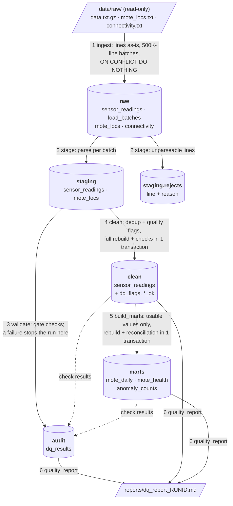

# Intel Berkeley Lab sensor pipeline

An ETL pipeline for the [Intel Berkeley Research Lab dataset](http://db.csail.mit.edu/labdata/labdata.html): 2.3 million readings (temperature, humidity, light, battery voltage) from 54 wireless sensor motes, recorded February 28 to April 5, 2004.

The pipeline loads the raw file into PostgreSQL through four layers (raw → staging → clean → marts), orchestrated by Apache Airflow, and runs with one `docker compose up`. The core of the project is **data quality**: every rule was derived from investigating the actual file first ([docs/findings.md](docs/findings.md)). Bad values are flagged, not deleted, and every run writes its check results to a table and a markdown report.

**Stack:** Python 3.11 · pandas · PostgreSQL 16 · Apache Airflow 2.10 · Docker Compose · pytest. No Spark; [why](DECISIONS.md#d1-pandas-not-pyspark).

---

## Results from an actual run

From a fresh `docker compose down -v && docker compose up -d` (Airflow run `scheduled__2026-10-09T00:00:00+00:00`, 2026-10-10). [Full report for that run](reports/dq_report_scheduled__2026-10-09T00_00_00_00_00.md).

| | rows | |
|---|---:|---|
| Lines in `data.txt.gz` → `raw` | 2,313,682 | 5 batches of ≤ 500,000 lines |
| Rejected in staging | 526 | 0.02 %; all `missing_moteid` |
| Staged | 2,313,156 | |
| Duplicates removed | 5 | same packet received twice |
| Clean | 2,313,151 | nothing else deleted |
| Clean rows with ≥ 1 quality flag | 542,046 | 23.4 % |
| Clean rows with no flag | 1,771,105 | 76.6 % |
| Usable temperature / humidity / light / voltage values | 1,871,843 / 1,906,274 / 2,219,799 / 2,313,143 | 80.9 / 82.4 / 96.0 / 100.0 % |
| Data-quality checks | 32 | 17 error-severity: **0 failed** · 15 warnings: **5 failed** (they describe the source data, below) |
| Motes alive at end / dead | 25 / 29 | |

**Runtime** (Windows 11 laptop, Docker Desktop; images already built and cached):

| task | initial load (s) | full backfill rerun (s) |
|---|---:|---:|
| ingest | 41.0 | 12.5 (0 new rows: idempotent) |
| stage | 50.8 | 71.4 |
| validate | 0.9 | 1.0 |
| clean | 33.6 | 54.7 |
| build_marts | 14.9 | 9.5 |
| quality_report | 4.0 | 4.7 |
| **DAG run** | **151.0** | **160.9** |

`docker compose up` → DAG finished: **188 s** wall clock (including Airflow start-up). A first-ever run also downloads the Postgres and Airflow images and builds one image, which takes longer and depends on your connection. Database size after the run: 1,450 MB.

After the backfill, every table had exactly the same row counts. Raw received 0 new rows.

---

## Architecture

Airflow DAG `wsn_sensor_pipeline` runs the six numbered steps in order (daily, incremental by default). Every layer is a Postgres schema in database `wsn`.



| layer | what it holds | how it's written | rerun behaviour |
|---|---|---|---|
| **raw** | Each source line exactly as written (`raw_line`), plus `source_file`, `source_line_no`, `batch_id`, `loaded_at`. Never updated. | COPY → temp table → `INSERT … ON CONFLICT (source_file, source_line_no) DO NOTHING` | Lines already loaded are skipped |
| **staging** | Typed columns (`TIMESTAMP`, `INTEGER`, `DOUBLE PRECISION`). Missing sensor values are NULL. Unparseable lines go to `staging.rejects` with all reasons. | pandas parser, per batch | `DELETE` batch + reinsert, in one transaction |
| **clean** | Staging minus true duplicates. `dq_flags TEXT[]` lists every rule a row tripped. `temperature_ok`, `humidity_ok`, `light_ok`, `voltage_ok` say which values are usable. | One SQL statement ([clean.sql](sql/transform/clean.sql)) | Full rebuild + post-condition checks in one transaction; a failed check rolls back to the previous version |
| **marts** | `mote_daily` (registered mote × day, dense grid: avg/min/max of usable values, expected vs actual readings), `mote_health` (alive/dead, delivery, gaps, battery trend), `anomaly_counts` (day × mote × flag) | SQL ([marts.sql](sql/transform/marts.sql)) | Full rebuild + reconciliation checks in one transaction |
| **audit** | `dq_results`: run id, batch, check, layer, severity, rows checked/failed, threshold, pass/fail | Upsert per (run, check, batch) | Retries overwrite rather than duplicate |

---

## Run it

**Prerequisites:** Docker Desktop (or Docker Engine with Compose v2), about 5 GB free disk (images ≈ 2.8 GB, database ≈ 1.5 GB), and port 5432 and 8080 free.

**1. Get the data** (not committed; 34 MB). From the project root:

```bash
curl -L -o data/raw/data.txt.gz    http://db.csail.mit.edu/labdata/data.txt.gz
curl -L -o data/raw/mote_locs.txt  http://db.csail.mit.edu/labdata/mote_locs.txt
curl -L -o data/raw/connectivity.txt http://db.csail.mit.edu/labdata/connectivity.txt
```

(Or download the three files from the dataset page into `data/raw/`.)

**2. Start everything:**

```bash
docker compose up -d
```

This builds the image, creates the schemas, initialises Airflow, and **runs the DAG once automatically**: it is unpaused at creation and the latest daily interval is due. About 3 minutes later:

- **Airflow UI:** http://localhost:8080 (user `admin`, password `admin`; local development only). DAG `wsn_sensor_pipeline`.
- **Quality report:** `reports/dq_report_<run_id>.md`
- **Database:** `docker exec -it wsn_postgres psql -U wsn -d wsn`, then e.g. `SELECT * FROM marts.mote_health ORDER BY last_seen;`

**Other operations**

| | |
|---|---|
| Reprocess everything | Airflow UI → *Trigger DAG w/ config* → `{"mode": "backfill"}`, or `docker exec wsn_airflow_scheduler airflow dags trigger wsn_sensor_pipeline -c '{"mode": "backfill"}'` |
| Load only new lines | default `{"mode": "incremental"}` (what the daily schedule does) |
| Run the tests | `docker exec -w /tmp wsn_airflow_scheduler python -m pytest -q /opt/wsn/tests` |
| Stop / reset | `docker compose down` / `docker compose down -v` (deletes the database) |

**Without Airflow** (local Python 3.11 venv, Postgres from compose): `pip install -r requirements.txt`, then

```bash
python -m pipeline ingest --mode backfill
python -m pipeline stage
python -m pipeline validate --run-id my_run
python -m pipeline clean    --run-id my_run
python -m pipeline marts    --run-id my_run
python -m pipeline report   --run-id my_run
python -m pytest -q tests
```

---

## Data quality

I profiled the whole file before writing any rule ([scripts/profile_raw.py](scripts/profile_raw.py) → [docs/data_profile.md](docs/data_profile.md)). The interpretation is in [docs/findings.md](docs/findings.md). What the investigation found, and what the pipeline does about it:

| finding (real numbers) | pipeline response |
|---|---|
| Empty fields are written as **two consecutive spaces**. Splitting on whitespace would silently shift voltage into the light column for ~93K rows. | Split on exactly one space; every line has 8 fields. Tested on the real lines. |
| (moteid, epoch) looks duplicated 113,557 times, but the rows are **~12.7 days apart**: epoch is a network-wide **16-bit counter that wraps** (and motes restart it on reboot). Only **5** are true duplicates. | Dedup = same mote, epoch *and* values, within 60 s → removes exactly 5. Deduplicating on (moteid, epoch) would have deleted ~113K real readings. |
| Bad values are a few **stuck readings tied to dying batteries**, not random outliers: temperature `122.153` × 370,196, humidity `-3.91901` × 212,232 and `-4` × 63,356. Every reading > 50 °C comes from a mote below 2.4 V. Below 2.30 V only 5.9 % of readings look plausible. | Physical ranges (temperature 0–50 °C, humidity 0–100 %, voltage 1.8–3.3 V) plus `low_battery` (< 2.30 V) invalidates temperature & humidity. |
| Epoch and timestamp disagree for some readings. Sample period measured at **30.001 s/tick** (r² = 0.9999999), not the documented 31 s. | `epoch_inconsistent`: > 2 h from the network's hourly median epoch, wrap-aware (18,114 rows). Expected readings use 30 s. |
| Motes go silent: 29 of 54 stopped > 24 h before the network did; 28 of those had a low battery, **mote 50 did not** (2.56 V). The network itself stopped ~2004-04-01 23:00, then a trickle continues to 04-05. | `mote_health` status, `low_battery_since`, battery trend. "Silent" is measured against when the network stopped, not the last timestamp. |
| **Two network-wide outages** (23 h on 03-10/11, 18 h on 03-15/16): no mote reported. | `network_outage_hours` check and a report section, so outages aren't mistaken for mote failures. |
| Unregistered mote ids 55–58 (~10K plausible rows) and 6485 / 33117 / 65407 (corrupt, 1 row each). Mote 28 never reports light. | Flagged `unknown_mote`, excluded from per-mote marts, counted in `anomaly_counts`. |

**Checks** ([pipeline/quality.py](pipeline/quality.py)) have a severity:

- **error**: the pipeline's own output would be wrong. These are raw→staging reconciliation, reject rate > 1 %, missing mote registry, `no_rows_lost`, `no_duplicates_remaining`, and marts reconciling to clean. A failure fails the Airflow task **immediately, without retries**, and the transactional rebuild leaves the previous clean/marts intact.
- **warn**: the source data is worse than tolerance. It's recorded and reported, and the pipeline continues, because those values are flagged and excluded from aggregates. Thresholds are policy (e.g. 5 % for value checks), **not tuned to make this dataset pass**. Five fail on this data: temperature out of range 17.64 %, low battery 17.45 %, humidity out of range 12.93 %, silent motes 29/54, outage hours 41/816.

---

## Pipeline behaviour

- **Batches:** the file is cut into a fixed grid of 500,000-line ranges. The batch id is derived from the range (`data.txt.gz:000500001-001000000`), so the same lines always map to the same batch. Line ranges rather than time windows because the file isn't time-ordered (227,448 lines are earlier than their predecessor).
- **Incremental vs backfill:** incremental resumes at the batch containing the first unloaded line; backfill walks every batch. I tested this by loading a 1.2M-line copy of the file and then the full file: the partial batch was topped up with 300,000 lines and two new batches were created, ending identical to one backfill.
- **Idempotency:** raw is insert-if-absent on (file, line). Staging is delete-and-reload per batch. Clean and marts are full rebuilds in one transaction. Check results are upserts. A full backfill over a loaded database inserted 0 raw rows and left every count unchanged.
- **Retries and failures:** 2 retries with exponential backoff (30 s, ~60 s), 30 min timeout per task, `max_active_runs=1`, and a failure callback that logs a single summary line. Both paths were tested:
  - A missing data file failed attempt 1 and succeeded on retry once the file was back.
  - An emptied mote registry failed `validate` on attempt 1 with no retries; downstream tasks were `upstream_failed`, and clean was untouched.
- **Tests:** 61 pytest tests.
  - Parser unit tests use real problem lines.
  - Batching and threshold tests.
  - **SQL rule tests against a throwaway Postgres database**, with one scenario per rule plus near-misses that must *not* be flagged: a step change vs a spike, the epoch wrap, identical values 61 s apart.
  - I checked that the tests can fail: breaking the spike threshold and the wrap-aware epoch logic made exactly the two corresponding tests fail.

---

## What I'd change at 100× scale

100× is ~230M readings (~3.4 GB gzipped, ~145 GB in Postgres if the current layout scaled linearly). Below, each measured bottleneck is followed by what I'd do. The projections are linear extrapolations of the timings above, not measurements.

1. **Many files, not one growing gzip.** gzip can't seek, so reaching batch *k* means decompressing everything before it (~2 s per 500K lines today; at 100× each incremental run would re-read GBs). Instead, sensors/gateways land hourly files in object storage (S3/GCS), and a file manifest table replaces the line grid as the unit of idempotency. Raw stays immutable there as compressed Parquet, rather than as 47 GB of `raw_line` text in Postgres.
2. **Partition by day and process only affected partitions.** Clean and marts are full rebuilds (34 s today → roughly an hour, plus sorts spilling to disk). That's correct today only because every batch spans every day. With time-partitioned arrival, the rules are naturally local: dedup is within 60 s, spikes need neighbours within 120 s, and the epoch consensus is per hour. So clean can be rebuilt per day-partition with a small overlap, and the marts per day. Postgres declarative partitioning or a warehouse's partitioned tables.
3. **Move parsing and transforms to an engine that parallelises.** Staging is single-threaded pandas (51 s today → ~85 min). This is where Spark becomes justified ([D1](DECISIONS.md#d1-pandas-not-pyspark)): partitioned parsing and window functions across workers. A columnar warehouse (BigQuery/Snowflake/ClickHouse) plus dbt is the other option, since the clean/marts logic is already SQL. dbt would also give per-model tests and lineage.
4. **Cheaper quality checks.** `no_rows_lost` is an anti-join over the whole table. At scale, reconcile counts per partition, check each new partition as it lands, and keep per-partition results. Fixed thresholds would become history-based ones (alert when a partition's failure rate deviates from its trailing baseline), because "17 % out of range" is normal for this network but a jump to 30 % would not be.
5. **Airflow topology.** Separate the Airflow metadata DB from the warehouse (they share a server today). Use dynamic task mapping (one task per file/partition) on a Celery or Kubernetes executor. Wire the failure callback to real alerting.
6. **Schema evolution and late data.** Late-arriving readings would re-open old day partitions. Track a watermark per partition and reprocess partitions that received late rows.

---

## Known trade-offs and limitations

- **The battery rule costs 33,112 readings.** These have in-range temperatures but are marked unusable because their voltage is < 2.30 V. I chose excluding drifted-but-plausible values over keeping them ([D18](DECISIONS.md#d18-low_battery--230-v-invalidates-temperature-and-humidity)).
- **Network outages aren't subtracted.** Mote delivery rates and gaps include the 41 outage hours; outages are reported separately instead ([D30](DECISIONS.md#d30-health-metrics-count-any-received-reading-flagged-or-not)).
- **The source file is assumed append-only.** A changed historical line would be ignored by raw ([D12](DECISIONS.md#d12-fixed-grid-batches-incremental-resumes-from-the-last-partial-batch)).
- **A run that fails before the report doesn't produce one.** Its failure is in `audit.dq_results` and the Airflow logs.
- **No alerting.** The failure callback logs; it doesn't notify.
- **Credentials are local-development values** in `docker-compose.yml`.

## Project layout

```
dags/wsn_pipeline.py          Airflow DAG (wiring only)
pipeline/                     all logic; also runnable as `python -m pipeline <step>`
  ingest.py                   raw load, batch grid, incremental/backfill
  parse.py                    line → typed values + reject reasons (pure, unit-tested)
  stage.py                    raw → staging + rejects
  quality.py                  check definitions, audit.dq_results, error vs warn
  clean.py / marts.py         run the SQL transforms + checks in one transaction
  report.py                   per-run markdown report
sql/init/                     DDL (runs on first `docker compose up`)
sql/transform/clean.sql       dedup + all data-quality rules
sql/transform/marts.sql       marts
tests/                        pytest: parser, batching, checks, SQL rules
scripts/profile_raw.py        exploratory profile of the raw file
docs/                         data_profile.md (generated), findings.md (interpretation)
reports/                      quality reports from real runs
DECISIONS.md                  every design choice and the alternative rejected
```
